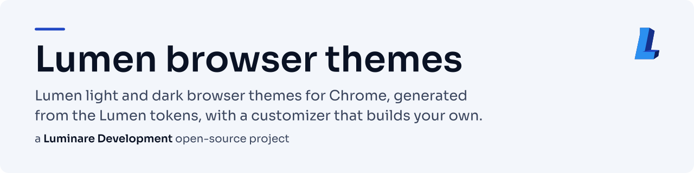
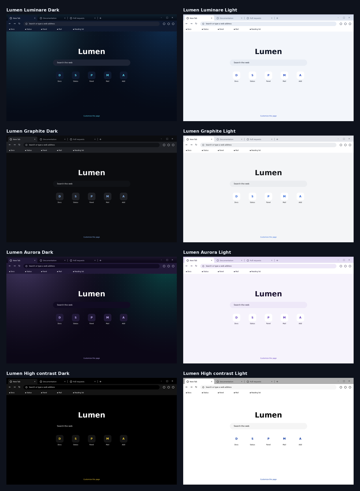

<!-- header:begin: brand-repos 0.1.0, variant studio, files in docs/brand/; the project-page sync drops this block -->
<picture>
  <source media="(prefers-color-scheme: dark)" srcset="docs/brand/readme-header-dark.svg">
  <source media="(prefers-color-scheme: light)" srcset="docs/brand/readme-header-light.svg">
  
</picture>

<!-- byline:studio -->
*a [Luminare Development](https://luminare.tech/open-source/lumen-chrome-theme/) open-source project*
<!-- /byline:studio -->
<!-- byline:personal
*by Paul Pasaurek · [project page](https://luminare.tech/open-source/lumen-chrome-theme/)*
/byline:personal -->

<!-- header:end -->

# Lumen browser themes

Light and dark Lumen themes for Google Chrome (and other Chromium browsers that take Chrome
themes), generated from the same design tokens as the Lumen panel themes, plus a one-page
customizer that builds your own theme ZIP in the browser.

[](https://github.com/luminare-dev/lumen-chrome-theme/actions/workflows/ci.yml)
[](https://github.com/luminare-dev/lumen-chrome-theme/actions/workflows/themes.yml)
[](LICENSE)



The sheet is drawn by CI from the generated theme files (`generator/preview.py`); the `themes`
workflow also loads each theme into headless Chromium and keeps a screenshot of its new tab page.

## Why

A browser theme is the one Lumen surface you see all day. Chrome themes are only a manifest with
colours and PNG images: no code, no settings and no automatic light or dark switch. So this
repository generates them instead of drawing them by hand: one token file in, one theme per mode
out, with the contrast checked on the way.

## What you get

- Four presets in two modes each: Luminare, Graphite, Aurora and High contrast, dark and light
  (eight themes). Incognito windows use the preset's dark palette in both.
- Every theme colours the frame, tabs, toolbar, address field, bookmarks bar and the new tab page.
  Dark themes get a soft accent light and a dot grid on the new tab page; light themes keep a
  plain background, because Chrome draws a white logo on any new tab image.
- Text pairs are checked against WCAG 2.2 (4.5:1 for text, 3:1 for toolbar icons) in the build.
- [The customizer](customizer/index.html): one HTML file that works offline and makes no network
  requests. Pick a preset and a mode or set every colour, see a live browser mock-up and download
  a ready theme ZIP. Token files import and export in the same format as the Lumen panel themes.

## Quickstart

Download a theme ZIP from the latest `themes` workflow run (artifact `themes`) or build one:

```bash
python3 generator/lumen_chrome.py --all --out dist      # every preset, both modes, plus ZIPs
python3 generator/validate.py dist/lumen-*-dark dist/lumen-*-light
```

Then unzip it, open `chrome://extensions`, turn on **Developer mode**, choose **Load unpacked** and
pick the folder. Details, removal and other browsers: [docs/install.md](docs/install.md).

## Make your own

Open `customizer/index.html` in any current browser (download the file, no server needed), or
build from a token file:

```bash
python3 generator/lumen_chrome.py my-tokens.json --out dist          # dark and light
python3 generator/lumen_chrome.py my-tokens.json --mode dark --out dist/mine --pattern none
```

See [docs/customize.md](docs/customize.md) for the colour mapping and the options.

## How it works

| Part | What it does |
|---|---|
| `presets/` | The Lumen token presets, copied from lumen-hydrodactyl-theme. |
| `generator/lumen_chrome.py` | Token JSON + mode → `manifest.json`, frame, toolbar and new tab PNGs, icons and a ZIP. Python standard library only. |
| `generator/validate.py` | Checks every manifest key against the keys Chromium reads, the images and the contrast pairs. |
| `generator/preview.py` | Draws the preview images and the contact sheet (Pillow, CI only). |
| `customizer/index.html` | The same colour mapping in JavaScript; images are drawn on a canvas and zipped in the page. |
| `tests/` | Unit tests and a parity test: the page and the generator must write the same manifest. |

## Limitations

- A theme cannot follow the system light or dark setting; install the mode you want, or switch by
  loading the other one.
- Chrome draws some parts itself (menus, the side panel, the new tab search box, the account
  links at the top right of the new tab page), so only the colours above follow the theme.
- Previews in the customizer and in `docs/previews/` are drawings; the real look depends on the
  browser version and the operating system.

## Documentation

- [docs/install.md](docs/install.md): load unpacked, update, remove, other Chromium browsers.
- [docs/customize.md](docs/customize.md): the customizer, the token mapping, building from the command line.

## Not affiliated

Not affiliated with or endorsed by Google. Chrome is named only to describe what these themes
work with.

## Licence

[MIT](LICENSE). The licence covers the code only: the project name, the Luminare logos, header
images and `docs/brand/` are not licensed (see [NOTICE](NOTICE)). The themes this repository
generates carry no Luminare logo.

<!-- byline:studio -->
*a [Luminare Development](https://luminare.tech/open-source/lumen-chrome-theme/) open-source project*
<!-- /byline:studio -->
<!-- byline:personal
*by Paul Pasaurek · [project page](https://luminare.tech/open-source/lumen-chrome-theme/)*
/byline:personal -->
